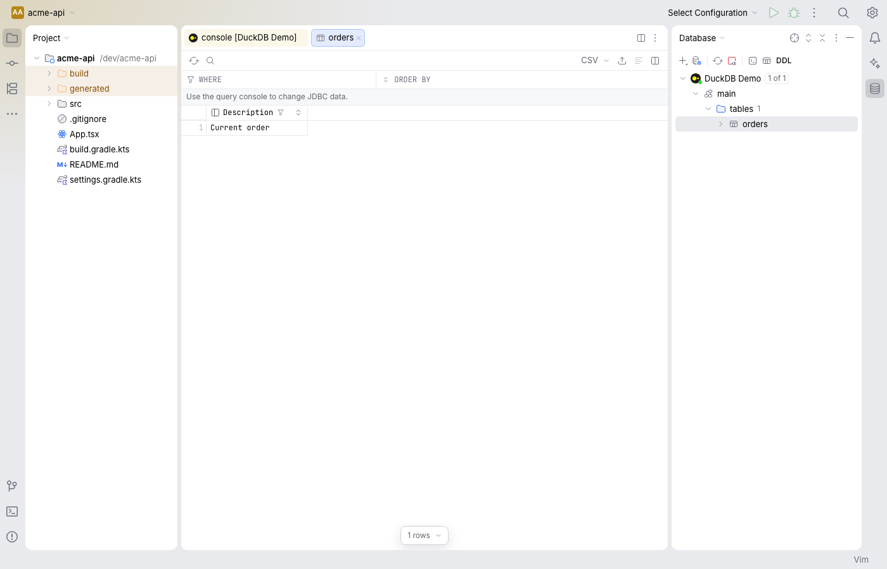
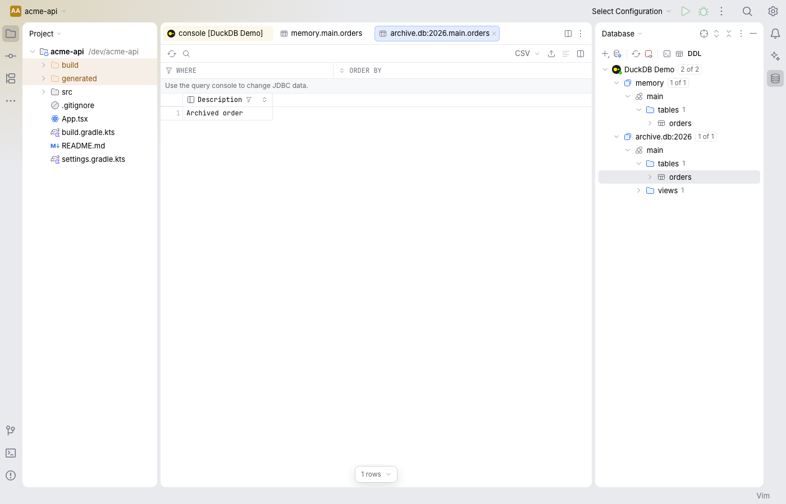
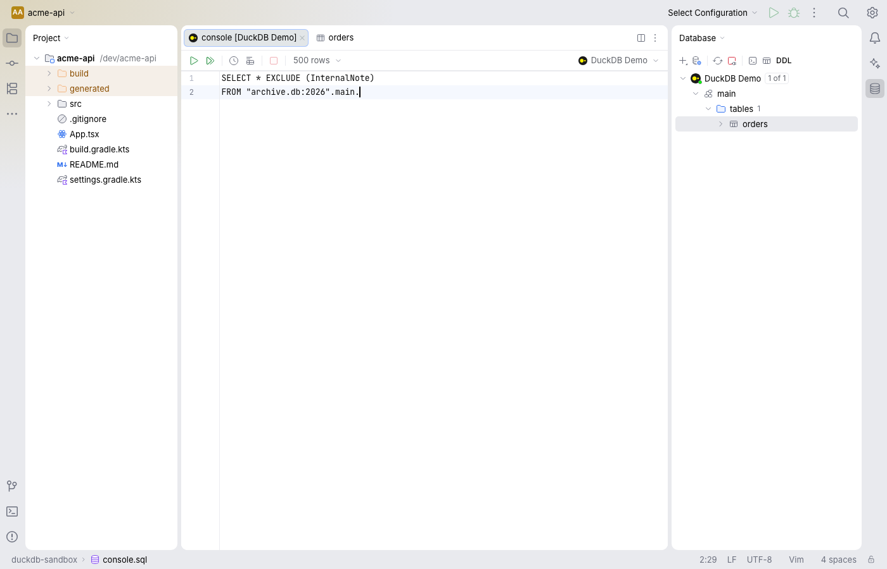
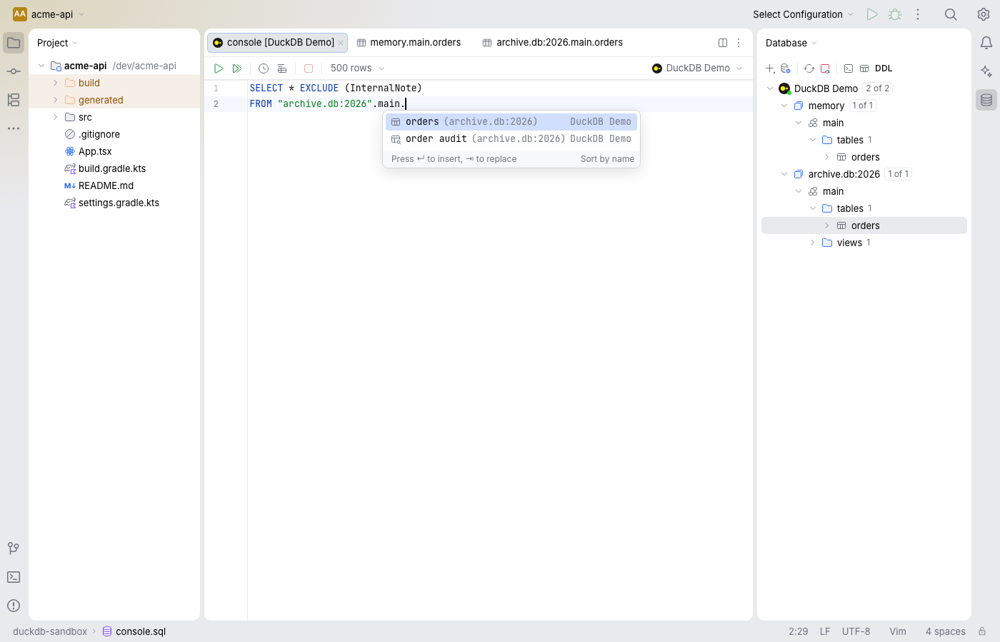

# DuckDB SQL and catalog browser evidence

Playwright Chromium recordings and screenshots use a synthetic connection fixture. The baseline is `521e00d075cc50bfbab281b74a1ef08ee41e3a51` and the feature run is `27620f9de3069060d4c42bba639ac31ad391ca24`.

| Workflow | Before | After |
| --- | --- | --- |
| Catalog tree and row preview |  |  |
| DuckDB SQL and completion |  |  |

[Watch the Chromium workflow](catalog-workflow.mp4).
